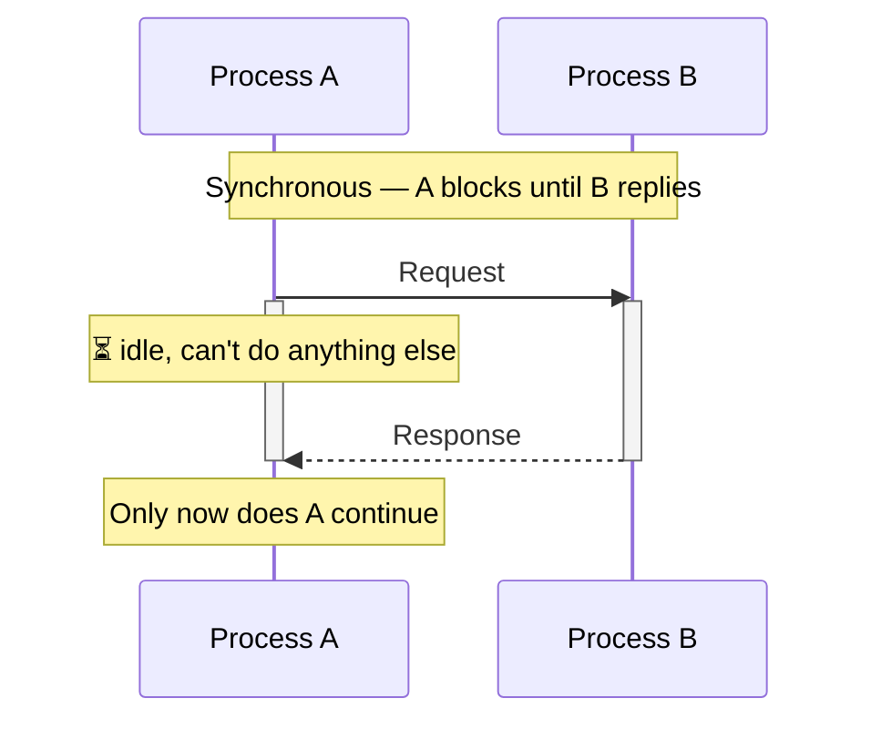
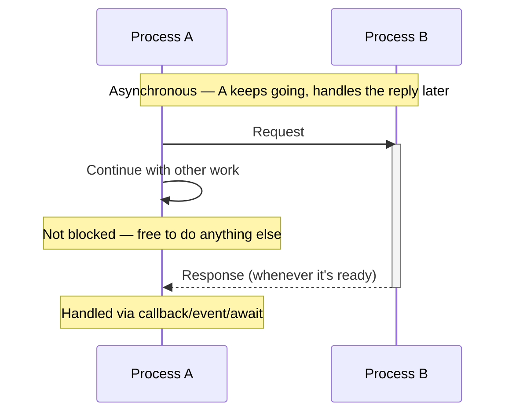

# JavaScript Notes

> basically like JavaScript but adding type safety

## 📑 Table of Contents

- [Variable Types](#variable-types)
- [var vs let/const (Scoping)](#var-vs-letconst-scoping)
- [Why JavaScript?](#why-javascript)
  - [👍 Pros](#-pros)
  - [👎 Cons](#-cons)
- [Numbers](#numbers)
- [Undefined vs. Undeclared](#undefined-vs-undeclared)
- [Null vs. Undefined](#null-vs-undefined)
- [Dynamic and Weak Typing](#dynamic-and-weak-typing)
- [Performance](#performance)
- [Strings](#strings)
  - [Template Literals](#template-literals)
  - [Advanced Logic in Template Literals](#advanced-logic)
- [Semi-Colons in JS](#semi-colons-in-js)
- [Camel Case in JS](#camel-case-in-js)
- [Equality Operators (`==` vs `===`)](#equality-operators)
- [Switch Statements](#switch-statements)
- [Truthy and Falsy](#truthy-and-falsy)
- [Nullish Coalescing (`??`)](#nullish-coalescing)
- [Functions in JavaScript](#functions-in-javascript)
  - [Summary](#summary)
  - [Docs](#docs)
  - [Examples](#examples)
  - [Function Hoisting](#function-hoisting)
  - [Multiple Return Values](#multiple-return-values)
- [Functions As Values](#functions-as-values)
- [Scope](#scope)
- [Anonymous Functions](#anonymous-functions)
- [Assignment (Exercise)](#assignment-exercise)
- [Passing by Value](#passing-by-value)
- [Objects](#objects)
  - [No Colon](#no-colon)
  - [Updating Properties](#updating-properties)
  - [Optional Chaining](#optional-chaining)
  - [Object Methods](#object-methods)
  - [Methods Mutate](#methods-mutate)
- [This](#this)
  - [Global Context](#global-context)
  - [Strict Mode](#strict-mode)
  - [Method Context](#method-context)
- [Arrow Functions](#arrow-functions)
  - [What's the Difference?](#whats-the-difference)
  - [Fat Arrows and This](#fat-arrows-and-this)
- [Spread Syntax](#spread-syntax)
- [Destructuring](#destructuring)
- [Not Bound](#not-bound)
- [Classes](#classes)
  - [Private Properties](#private-properties)
  - [Static Methods](#static-methods)
  - [Getters and Setters](#getters-and-setters)
  - [Super](#super)
- [Prototypal Inheritance](#prototypal-inheritance)
  - [Prototype Chains](#prototype-chains)
  - [How Are Parent Members Accessed?](#how-are-parent-members-accessed)
- [For...in Loops](#forin-loops)
- [Arrays](#arrays)
  - [Array Spread](#array-spread)
  - [Includes](#includes)
  - [For...of Loops](#forof-loops)
  - [Slicing Arrays](#slicing-arrays)
  - [Sequence Slicing](#sequence-slicing)
  - [const Arrays](#const-arrays)
  - [Destructuring Arrays](#destructuring-arrays)
- [Error Handling](#error-handling)
  - [Error Object](#error-object)
  - [Handling Errors](#handling-errors)
  - [Finally](#finally)
  - [Throwing Errors](#throwing-errors)
  - [When to try/catch](#when-to-trycatch)
- [Sets](#sets)
  - [Set Composition](#set-composition)
- [Maps](#maps)
  - [Map Keys](#map-keys)
  - [Map vs. Object](#map-vs-object)
- [Synchronous vs. Asynchronous](#synchronous-vs-asynchronous)
  - [Why Async?](#why-async)
- [Promises](#promises)
  - [Creating a Promise](#creating-a-promise)
  - [Working With Promises](#working-with-promises)
  - [Why Promises?](#why-promises)
  - [I/O](#io)
- [Async/Await](#asyncawait)
  - [Await](#await)
  - [Handling Rejections](#handling-rejections)
  - [Async Keyword](#async-keyword)
  - [then vs. await](#then-vs-await)
- [Single Threaded](#single-threaded)
- [Non-Blocking](#non-blocking)
  - [The Call Stack](#the-call-stack)
  - [Task Queue](#task-queue)
  - [Microtask Queue](#microtask-queue)
  - [Concurrency](#concurrency)

---

## Variable Types

Some of JavaScript's most common variable types are:

| Type | Description |
|---|---|
| `number` | represents both integer and floating-point numbers |
| `boolean` | either `true` or `false` |
| `string` | a sequence of characters |
| `undefined` | a variable that hasn't been assigned a value |

---

## var vs let/const (Scoping)

> `var` is function-scoped, so a variable declared inside an `if` block can leak outside it! `let` and `const` are block-scoped, which is always usually what you want.

> 🎯 **Remember for interviews:** `var` is function-scoped (can leak out of `if` blocks); `let`/`const` are block-scoped.

---

## Why JavaScript?

Here's the deal, JavaScript is the only language that runs in the browser. (okay, there's WebAssembly, but that's different). If your app is accessed via a web browser, it's almost certainly gonna need some JavaScript.

JavaScript has some serious things going for it:

### 👍 Pros

- Almost every technology company uses it somehow, so there are a lot of jobs
- C-style syntax, so it's easy to learn if you know any other C-style language
- Many built-in features that are particularly useful on the web
- Can be used for both front-end and back-end development, simplifying an org's tech stack
- Big companies have invested a lot in making it better and faster over the years
- Great support for asynchronous programming

It also has some things I don't like:

### 👎 Cons

- Not statically typed (although TypeScript helps)
- Legacy baggage (like `var` and old code that doesn't use promises)
- Weird quirks (like `==` vs `===`)
- Always acts slightly differently in every browser/runtime

---

## Numbers

Unlike languages with separate integer and floating-point types, JavaScript uses a single `Number` type for both.

You can use `+=` to increment a number by any amount, or the `++` operator to increment by just 1.

---

## Undefined vs. Undeclared

The primitive `undefined` value represents the absence of a value... but it's not the same thing as an "undeclared" variable!

We can create an undefined variable by giving it a name, but no value:

```js
let favoriteSandersonCharacter; // undefined
console.log(typeof favoriteSandersonCharacter); // "undefined"
```

However if we never create the name, it's "undeclared", and undeclared variables actually throw an error (so don't do this):

```js
console.log(favoriteRothfussCharacter); // ReferenceError: favoriteRothfussCharacter is not defined
```

The worst part is that the undeclared variable error actually says "not defined"... welcome to JavaScript. 🤦‍♂️

> 🎯 **Remember for interviews:** `undefined` (declared, no value) vs **undeclared** (never created — throws `ReferenceError`, which confusingly says "not defined").

---

## Null vs. Undefined

If you're coming from Python, you might be thinking:

> Ah, so `undefined` is like `None`! Easy peasy.

Yes. But also... no. One of JavaScript's most cursed features is that it has two values for "nothing":

- **`undefined`**: It doesn't exist at all. In grug-speak `undefined` is "very nothing"
- **`null`**: It (kind of) exists, but it's empty. In grug-speak `null` is "kinda nothing"

There are some practical differences between the two, the primary one being that `undefined` is the default value of a variable when it hasn't been given a value yet.

```js
let myName;
console.log(myName); // undefined
```

To get a null value, you have to explicitly assign it:

```js
let myName = null;
console.log(myName); // null
```

Confusingly, `typeof` returns `"object"` for `null`:

```js
console.log(typeof null); // object
```

To be clear, `null` is its own type according to the ECMAScript specification, but the `"object"` type report is a historical quirk that can't be easily fixed now.

In most cases, `null` and `undefined` work the same way, but you'll want to be consistent in how you use them, and know that there are subtle behavioral differences.

> 🎯 **Remember for interviews:** `typeof null === "object"` — a famous JS quirk/historical bug, but `null` is its own type per spec. `undefined` = never assigned; `null` = explicitly assigned "empty".

---

## Dynamic and Weak Typing

Like Python, Ruby, and PHP, JavaScript is a dynamically-typed (not statically-typed) language. Its variable types are only known at runtime (yes, yes, we'll talk about TypeScript in another course). Some of us like being able to see the types of our variables in our editors, okay?

Now, unlike Python, it's also weakly-typed, meaning it will automatically convert types when you do things like add a number to a string. This can lead to some unexpected behavior if you're not careful...

```js
let answerToLife = 42;
let answerToTheUniverse = "42";

// obviously JavaScript thinks that adding strings
// and numbers is totally sane and normal behavior
const answerToEverything = answerToLife + answerToTheUniverse;

console.log(answerToEverything);
// "4242"
```

> 🎯 **Remember for interviews:** JS is **dynamically typed** (types known at runtime) AND **weakly typed** (implicit type coercion) — e.g. `42 + "42" === "4242"`.

---

## Performance

I want to be clear, comparing the "speed" or "efficiency" of programming languages is as far from an exact science as "astrology"... okay, maybe not quite that bad. But there are a lot of variables and moving parts, so benchmarks can be misleading.

I just want to point out a few high-level things to give you some kind of frame of reference:

- JavaScript is not as fast as C, Rust or Zig. It's almost always going to be outperformed by non-garbage-collected languages.
- Modern JavaScript is typically JIT-compiled (just-in-time compiled) into machine code via the V8 engine at runtime. It's usually not as fast as AOT (ahead-of-time) compiled languages like Go or C, but it's usually much faster than interpreted languages like Python or Ruby.
- JavaScript runs on a single thread, but has great support for asynchronous programming. It's typically not as performant for CPU-bound tasks (like heavy math calculations), but it does well for I/O-bound tasks (like contacting a database or making an API call).

> 🎯 **Remember for interviews:** JS = single-threaded + JIT-compiled (V8) + great at async I/O-bound work, weaker at CPU-bound work.

---

## Strings

The `.length` property is used to get the number of characters in a string.

> ⚠️ no negative indexing in JavaScript

### Template Literals

In JavaScript, template literals are a fantastic way to interpolate dynamic values into a string. They're JavaScript's version of Python's f-strings. For example:

```js
const shadeOfRed = 101;
console.log(`The shade is ${shadeOfRed}`);
// The shade is 101
```

Template literals must start and end with a backtick, and anything inside of the dollar-sign bracket enclosure is automatically cast to a string.

### Advanced Logic

You aren't limited to just variable names inside the `${}`. You can actually write valid JavaScript code directly inside them.

This means you can do math, change text styles, or run logic checks right inside the string.

```js
const price = 2.5;
const quantity = 3;
const item = "coffee";

console.log(`Total: $${price * quantity}`);
// Total: $7.5

console.log(`I need ${item.toUpperCase()}`);
// I need COFFEE
```

---

## Semi-Colons in JS

In JavaScript, semicolons are optional as a terminating character. They can be inserted by the JavaScript engine automatically during the parsing phase. However, most developers (us included) prefer to use semi-colons to avoid any confusion or errors that can arise from automatic insertion.

---

## Camel Case in JS

By convention in Python, Ruby, and Rust, most programmers use `snake_case` to write variable names. In JavaScript, the more-popular convention (and the one we use) is `camelCase`.

Here are some casing examples:

- `camelCase`
- `snake_case`
- `PascalCase`
- `SCREAMING_SNAKE_CASE`

Again, prefer `camelCase` when writing JavaScript code.

---

## Equality Operators

The equality operators, however, are a bit... strange. To compare two values to see if they are exactly the same, use the strict equality (`===`) and strict inequality (`!==`) operators:

```js
5 === 6; // evaluates to false
5 !== 6; // evaluates to true
```

The "normal" equality (`==`) and inequality (`!=`) operators are a bit more... flexible:

```js
5 == 6; // evaluates to false
5 == "5"; // evaluates to true

5 != 6; // evaluates to true
5 != "5"; // evaluates to false
```

The "strict equals" (`===`) and "strict not equals" (`!==`) compare both the value and the type. The "loose equals" (`==`) and "loose not equals" (`!=`) attempt to convert and compare values of different types. With the loose versions, the string `'5'` and the number `5` are considered "equal", which, in good code, is usually not what you want.

This is a fairly unique quirk of the JavaScript language.

> 🎯 **Remember for interviews:** `===`/`!==` compare value **and** type. `==`/`!=` coerce types first (e.g. `5 == "5"` is `true`). Prefer strict equality in good code.

---

## Switch Statements

Switch statements are a way to compare a variable against multiple possible values. They are similar to if-else statements, but tend to be more readable when there are many potential options.

```js
const os = "mac";
let creator;
switch (os) {
  case "linux":
    creator = "Linus Torvalds";
    break;
  case "windows":
    creator = "Bill Gates";
    break;
  case "mac":
    creator = "Steve";
    break;
  default:
    creator = "Unknown";
    break;
}

console.log(creator);
// Steve
```

Unlike some languages where fall-through doesn't happen by default, JavaScript will continue to execute the next case until it reaches a break or return statement.

99 times out of 100, you'll want to include a break/return statement after each case to prevent this behavior.

> 🎯 **Remember for interviews:** `switch` **falls through** by default — always add `break`/`return` unless fall-through is intentional.

---

## Truthy and Falsy

**Falsy:** `0`, `null`, `undefined`, `false`, `NaN`, `""`

**Truthy:** anything that is not falsy

Common truthy values include:

- `true`
- `42` (any number that isn't 0)
- `"hello"` (any non-empty string)
- `[]` (an empty array)
- `{}` (an empty object)
- `function() {}` (an empty function)

Common falsy values include:

- `false`
- `0`
- `""` (an empty string)
- `null`
- `undefined`
- `NaN` (Not a Number)

> 🎯 **Remember for interviews:** `[]` and `{}` are **truthy**, even though they look "empty" — a classic gotcha.

---

## Nullish Coalescing

JavaScript is truly a language built for the web, and the web runs on... uncertainty.

It's kinda crazy how much production JavaScript exists solely to handle cases where a value might be `null` or `undefined`.

The nullish coalescing operator `??` is a way to handle these cases in a more concise way.

```js
let myName = null;
console.log(myName ?? "Anonymous"); // "Anonymous"

myName = "Lane";
console.log(myName ?? "Anonymous"); // "Lane"
```

If the value on the left of `??` is `null` or `undefined`, the value on the right is returned. Otherwise, the value on the left is returned. It's a way to set sane defaults for variables that might be empty.

This is especially handy for setting defaults without accidentally overriding legitimate falsy values like `0`, `false`, or `""` — which is exactly where the older "default via `||`" pattern falls apart:

```js
function getVolume(volume) {
  const withOr = volume || 50; // BAD: || clobbers a real value of 0
  const withNullish = volume ?? 50; // GOOD: ?? only replaces null/undefined

  return { withOr, withNullish };
}

console.log(getVolume(0));
// { withOr: 50, withNullish: 0 } -- || wrongly overrides a valid 0

console.log(getVolume(undefined));
// { withOr: 50, withNullish: 50 } -- both agree when the value is actually missing
```

**Where to use it:** anywhere you're providing a default/fallback for something that might legitimately be `0`, `false`, or `""` — optional function parameters, config objects, API responses, query params, or env values. If `0` or `""` should count as a real, intentional value (a volume level, a search query, a quantity), reach for `??` instead of `||`.

> 🎯 **Remember for interviews:** `??` only falls back on `null`/`undefined` — unlike `||`, it does **not** trigger on other falsy values like `0` or `""`.

---

## Functions in JavaScript

### Summary

A function declaration starts with the function keyword, then a name, a parenthesized list of parameters, and a body in braces. Calling the function by name with arguments in parentheses runs the body.

`return` sends a value back to the caller and ends the function. A function that never hits a return returns `undefined`.

Parameters have no type annotations. Calling a function with fewer arguments than parameters doesn't throw an error: the missing ones are `undefined`. Extra arguments are ignored.

> 🎯 **Remember for interviews:** a function with no (or no reached) `return` statement returns `undefined`. Missing arguments become `undefined` rather than throwing.

### Docs

- Functions (guide)
- function declaration
- return

### Examples

**Declaring and calling:**

```js
function area(width, height) {
  return width * height;
}

console.log(area(3, 4));
// 12
```

**No return means undefined:**

```js
function logGreeting(name) {
  console.log(`hi ${name}`);
}

const result = logGreeting("Ada");
// hi Ada
console.log(result);
// undefined
```

**Missing arguments are undefined:**

```js
function area(width, height) {
  return width * height;
}

console.log(area(3));
// NaN
```

---

### Function Hoisting

In Python, a function must be defined before any code that executes it. But that's not so in JavaScript! As long as a function is defined somewhere in the file, it can be called even before the definition.

```js
console.log(getLabel(3));
// prints 'awful'

function getLabel(numStars) {
  if (numStars > 7) {
    return "great";
  } else if (numStars > 3) {
    return "okay";
  } else {
    return "awful";
  }
}
```

This works because JavaScript "hoists" the function declaration to the top of the file before the code is executed.

> 🎯 **Remember for interviews:** function **declarations** are hoisted — callable before their definition appears in the file.

---

### Multiple Return Values

Many languages allow multiple values to be returned from a function. For example, in Python this works:

```python
def get_user():
    return "name@domain.com", 21, "active"


email, age, status = get_user()
```

However, in JavaScript, that's not allowed!

```js
function getUser() {
  return "name@domain.com", 21, "active";
  // DON'T DO THIS
  // it only returns 'active'
}
```

Strangely, the JavaScript code above won't actually throw any sort of error, it will just silently return the `"active"` string.... which is unintuitive behavior that you probably didn't want. You can only return one value from a function in JavaScript!

To get around this, most developers return an object that contains the values they want to return. We'll cover objects later.

> 🎯 **Remember for interviews:** JS functions can only return **one** value. `return a, b, c` silently evaluates to just the last value (`c`) via the comma operator — no error thrown. Use an object to return multiple values.

## Functions As Values

JavaScript supports first-class and higher-order functions, which are just fancy ways of saying "functions as values". Functions can be treated like any other data type – such as numbers and strings and booleans. Let's assume we have two simple functions:

```js
function add(x, y) {
  return x + y;
}

function mul(x, y) {
  return x * y;
}
```

We can create a new aggregate function that accepts a function as its 4th argument:

```js
function aggregate(a, b, c, arithmetic) {
  const firstResult = arithmetic(a, b);
  const secondResult = arithmetic(firstResult, c);
  return secondResult;
}
```

It calls the given arithmetic function (which could be `add` or `mul`, or any other function that accepts two parameters and returns a number) and applies it to three inputs instead of two. It can be used like this:

```js
function main() {
  const sum = aggregate(2, 3, 4, add);
  // sum is 9
  const product = aggregate(2, 3, 4, mul);
  // product is 24
}
```

> 🎯 **Remember for interviews:** functions are **first-class values** in JS — you can pass them as arguments (higher-order functions) just like numbers or strings.

---

## Scope

Scope in JavaScript defines where variables and functions are accessible in your code, and it can behave differently depending on the environment (such as a browser or Node.js). There are four levels, from highest to lowest:

**Global Scope:**
- Variables declared globally have the highest level of scope and can be accessed from anywhere in your code.
- In browsers, global variables are properties of the `window` object. For example, `window.myGlobalVar = 'hello world'` defines a global variable.
- In Node.js, global variables are properties of the `global` object: `global.myGlobalVar = 'hello world'`.

**Module Scope:**
- In ES modules (both in Node.js and modern browsers), variables declared at the top level of a module are scoped to that module. They are not added to the global scope.
- In the browser, using `<script type="module">` creates a module scope for that script.
- We'll cover modules in a later chapter.

**Function Scope:**
- Variables declared with `var` (we try to avoid this) are limited to the function scope. They are accessible only within that function and any nested functions.

**Block Scope:**
- ES6 introduced block scope with the `let` and `const` keywords. A block is typically defined by curly braces `{}`, like in `if` statements, loops, and other blocks of code.
- Variables declared with `let` and `const` are confined to their block, making them more predictable and reducing the chances of accidental variable hoisting.

> 🎯 **Remember for interviews:** scope order, highest to lowest — **Global → Module → Function → Block**.

---

## Anonymous Functions

Anonymous functions are true to form in that they have no name. They're useful when defining a function that will only be used once or to create a quick closure.

> 💡 **What's a closure?** A function that "remembers" the variables from the scope it was created in, even after that outer scope has finished running.

Let's say we have a function `conversions` that accepts another function, `converter` as input:

```js
function conversions(converter, x, y, z) {
  const convertedX = converter(x);
  const convertedY = converter(y);
  const convertedZ = converter(z);
  console.log(convertedX, convertedY, convertedZ);
}
```

We could define a function normally and then pass it in by name... but if we only want to use it in this one place, we can define it inline as an anonymous function:

```js
// using a named function
function double(a) {
  return a + a;
}
conversions(double, 1, 2, 3);
// 2 4 6

// using an anonymous function
conversions(
  function (a) {
    return a + a;
  },
  1,
  2,
  3,
);
// 2 4 6
```

> 🎯 **Remember for interviews:** anonymous functions are great for one-off callbacks; they're also how you commonly create a closure inline.

### Summary

An anonymous function is a function with no name. It's written as a function expression, `function (params) { ... }`, wherever a value is expected. The most common place is inline as an argument, when a callback is only needed once and a named function would be clutter.

Arrow functions (`(x) => x * 2`) are also anonymous and are the more common way to write short callbacks in modern code.

### More Examples

**Named function passed by name:**

```js
function applyAll(fn, a, b) {
  console.log(fn(a), fn(b));
}

function square(n) {
  return n * n;
}

applyAll(square, 3, 4);
// 9 16
```

**Same thing with an anonymous function:**

```js
function applyAll(fn, a, b) {
  console.log(fn(a), fn(b));
}

applyAll(
  function (n) {
    return n * n;
  },
  3,
  4,
);
// 9 16
```

**Storing an anonymous function in a variable:**

```js
const half = function (n) {
  return n / 2;
};
console.log(half(9));
// 4.5
```

### 📚 Good to Know (fills the gaps above)

- **Expressions vs. declarations:** a `function` keyword used as a *value* (assigned to a variable, passed as an argument) is a **function expression**; one written as its own top-level statement with a name is a **function declaration**. Only declarations get [hoisted](#function-hoisting) — anonymous function expressions do **not**, so they can only be called after the line that defines them runs.
- **Arrow functions** (`(n) => n * n`) are shorthand anonymous function expressions. Key differences from regular `function`s: no own `this`/`arguments` (they inherit from the enclosing scope), can't be used as constructors (no `new`), and have no `.prototype`.
- **Where you'll see them most in real code:** callbacks for array methods like `.map()`, `.filter()`, `.forEach()`, `.reduce()`; event listeners (`el.addEventListener("click", () => {...})`); and promise handlers (`.then(() => {...})`).
- **IIFE (Immediately Invoked Function Expression):** an anonymous function called the instant it's defined — `(function () { ... })();` — a classic pattern for running code once in its own scope without polluting the outer one.
- **Debugging tip:** a pure anonymous function shows up as `(anonymous)` in stack traces/debugger tools, which can make bugs harder to trace. Giving a function expression a name (`const double = function double(a) { ... }`) keeps the anonymity in usage but restores a readable name in stack traces.

> 🎯 **Remember for interviews:** anonymous function *expressions* are **not hoisted** (unlike named function *declarations*) — that's a common interview trip-up.

---

## Assignment (Exercise)

Complete the `printReports` function. It takes a sequence of messages, `intro`, `body`, and `outro`. It should call `printCostReport` once for each message, in order.

For each call to `printCostReport`, you should pass:

- an anonymous function that calculates the cost of a message as an integer
- the message itself

The cost for each type of message is calculated like this:

- Intro: 2x the message length
- Body: 3x the message length
- Outro: 4x the message length

Use the built-in `length` property to get the length of a string:

```js
const helloLen = "hello".length;
// helloLen = 5
```

## Passing by Value

Variables in JavaScript are typically passed by value (except for objects and arrays, which we'll talk about later and are passed by reference). "Pass by value" means that when a variable is passed into a function, that function receives a copy of the variable. The function is unable to mutate the caller's original data.

```js
let x = 5;
increment(x);
console.log(x);
// 5

function increment(x) {
  x++;
  console.log(x);
  // 6
}
```

> 🎯 **Remember for interviews:** primitives are passed **by value** (a copy) — mutating the parameter inside the function doesn't affect the caller's variable. Objects/arrays are passed **by reference**.

---

## Objects

JavaScript objects are an almost weirdly versatile collection type. Object literals (POJOs, or "plain old JavaScript objects") are often used to store data in key-value pairs.

```js
const apple = {
  name: "Apple",
  radius: 2,
  color: "red",
};
```

You can access properties stored on an object using the `.` operator:

```js
console.log(apple.name); // prints "Apple"
console.log(apple.radius); // prints "2"
console.log(apple.color); // prints "red"
```

JavaScript objects are interesting because you'll use them the way you'd probably use a map or a dictionary in other languages (simple key-value pairs), but they can also be used for more complex things like classes and prototypes... which we'll get into later.

### No Colon

The `key: value` syntax is the normal way to create key-value pairs in an object, but if you want a key to have the same name as an existing variable, you can omit the colon and the value. These are the same:

```js
const radius = 2;
const color = "red";
const apple = {
  radius: radius,
  color: color,
};
```

```js
const radius = 2;
const color = "red";
const apple = {
  radius, // same as radius: radius
  color: color, // set explicitly for demonstration
};
```

### Updating Properties

You can update and add new keys (you'll see me use the words "property" and "key" interchangeably in this course) to an existing object using the `.` operator. If it exists, it's updated; if it doesn't, it's created as a new property:

```js
const apple = {
  name: "Apple",
  radius: 2,
  color: "red",
};

apple.numSeeds = 3; // new property
apple.color = "green"; // update property
// {"name":"Apple","radius":2,"color":"green","numSeeds":3}
```

### Optional Chaining

Nested data can quickly become hard to work with. In most production systems you'll deal with 3-4 levels of object nesting on a regular basis.

When using the normal `.` operator, if the object on the left side of the `.` is `null` or `undefined`, you'll get a `TypeError` at runtime! Thankfully, JavaScript has recently added a new operator to make dealing with this headache easier, the optional chaining operator: `?.`

```js
const tournament = {
  prize: {
    units: "dollars",
    value: 100,
  },
};

const h = tournament.referee.height;
// TypeError: Cannot read properties of undefined (reading 'height')
```

So, if you're not sure whether the `referee` property exists (maybe it was sent to us over the network) we can use the optional chaining operator to avoid the error:

```js
const tournament = {
  prize: {
    units: "dollars",
    value: 100,
  },
};

const h = tournament.referee?.height;
// h is simply undefined, no error is thrown
```

> 🎯 **Remember for interviews:** `?.` short-circuits to `undefined` instead of throwing when the left-hand side is `null`/`undefined` — great for safely accessing nested/uncertain data.

### Object Methods

JavaScript objects can have methods, just like classes in Python or structs in Go. Objects are interesting in JavaScript because they play the role of dictionaries and classes in other languages (Yes, JS also has classes, but we'll get to them later).

Methods are functions that are defined on an object. They can access and change the properties of the object in question. In the context of an object method, the `this` keyword refers to the object itself, like `self` in Python (we'll talk about the admittedly hairy `this` keyword in more detail later).

```js
const person = {
  firstName: "Lane",
  lastName: "Wagner",
  getFullName() {
    return this.firstName + " " + this.lastName;
  },
};

console.log(person.getFullName());
// Lane Wagner
```

### Methods Mutate

Methods can change the properties of their objects as well:

```js
const tree = {
  height: 256,
  color: "green",
  cut() {
    this.height /= 2;
  },
};

tree.cut();
console.log(tree.height);
// prints 128

tree.cut();
console.log(tree.height);
// prints 64
```

You might be wondering:

> Wait... I thought `tree` was a constant?!?

You're right, but in JavaScript, the `const` keyword doesn't stop you from changing the properties of an object... it only stops you from reassigning the variable (`tree` in this case) to a new object. Do not trust `const` objects to have constant contents!

> 🎯 **Remember for interviews:** `const` only locks the **binding** (the variable can't be reassigned), not the object's contents — object/array properties stay fully mutable.

---

## This

The `this` keyword is perhaps one of the most rage-inducing parts of JavaScript. Once you understand it, it's not too bad, but it's far from intuitive (in my opinion).

Put simply, `this` refers to the context where a piece of code is executed... let's cover some of those cases:

### Global Context

`this` refers to the `window` object in browsers or `module.exports` in Node.js (not `global`, as you might expect).

```js
// in a browser
console.log(this);
// Window { ... }

// in Node.js
console.log(this);
// {}
```

### Strict Mode

In strict mode (which we'll cover later, don't worry about it too much for now) `this` is `undefined` in the global scope in both the browser and Node.js.

```js
"use strict";
console.log(typeof this);
// undefined
```

### Method Context

Inside a standard method or a constructor, `this` refers to the object the method is called on.

```js
const myObject = {
  message: "Hello, World!",
  myMethod() {
    console.log(this);
    console.log(this.message);
  },
};
myObject.myMethod();
// { message: 'Hello, World!', myMethod: [Function: myMethod] }
// Hello, World!
```

> 🎯 **Remember for interviews:** `this` is **not fixed** — it depends on *how* a function is called: global context → `window`/`module.exports` (or `undefined` in strict mode); as an object method → the object itself.

## Arrow Functions

Fat arrow functions, or "arrow functions" are another way to define functions in JavaScript. Arrow functions are newer than the `function` keyword, however, unlike the `let`/`const` syntax, arrow functions are sometimes better, not always better.

```js
// declaring a function without a variable
function add(x, y) {
  return x + y;
}

// declaring a function with a variable
const add = function (x, y) {
  return x + y;
};

// using the fat arrow syntax
const add = (x, y) => {
  return x + y;
};
```

It's so cool and not confusing at all that there are 3 ways to do (basically) the same thing...

### What's the Difference?

- Fat arrow functions are usually declared as variables, while the `function` keyword may or may not be declared as a variable.
- Fat arrow functions handle object scoping in a more intuitive way (we'll talk about this later)
- Fat arrow functions don't work as constructors (we'll talk about this later)
- Other minor differences

### Fat Arrows and This

One reason to choose an arrow function over a regular function or method is to preserve the `this` context. It's particularly useful when working with objects. To be fair, in a simple object like this, the non-arrow method makes perfect sense:

```js
const author = {
  firstName: "Lane",
  lastName: "Wagner",
  getName() {
    return `${this.firstName} ${this.lastName}`;
  },
};
console.log(author.getName());
// Prints: Lane Wagner
```

With a fat-arrow function, the `this` keyword refers to the same context as its parent. In essence, fat arrow functions "preserve" the `this` context. That's why `this` isn't `author` in this example. At the top level of a module, `this` is `undefined`, so the call throws:

```js
const author = {
  firstName: "Lane",
  lastName: "Wagner",
  getName: () => {
    return `${this.firstName} ${this.lastName}`;
  },
};
console.log(author.getName());
// TypeError: Cannot read properties of undefined (reading 'firstName')
```

Developers working in some front-end (yuck) JavaScript frameworks (like React or Vue) tend to use fat arrow functions often. The `this` context can contain a ton of component-wide state, and it needs to be preserved throughout nested function calls, so fat arrows make the code easier to read and write.

> 🎯 **Remember for interviews:** regular methods get their own `this` (set by how they're called); arrow functions have **no own `this`** — they inherit it lexically from the enclosing scope. That's why an arrow-function method can't see its object via `this`.

---

## Spread Syntax

JavaScript has a really nifty spread syntax (`...`) for moving groups of object properties around. It's a great way to copy objects and merge object properties.

```js
const engineeringDept = {
  lane: "grand magus",
  hunter: "software engineer",
  allan: "software engineer",
  matt: "software engineer",
  dan: "software engineer",
  waseem: "software engineer",
};

const videoDept = {
  stass: "video producer",
  alex: "video producer",
};

const allEmployees = { ...engineeringDept, ...videoDept };
/*
{
  lane: 'grand magus',
  hunter: 'software engineer',
  allan: 'software engineer',
  matt: 'software engineer',
  dan: 'software engineer',
  waseem: 'software engineer',
  stass: 'video producer',
  alex: 'video producer'
}
*/
```

The spread syntax shallow-copies the properties of the objects you're spreading. If properties have the same name, the last (right-most) object's property will overwrite the previous ones.

```js
const engineeringDept = {
  lane: "software engineer",
  hunter: "software engineer",
};

const videoDept = {
  lane: "cringe youtuber",
  alex: "video producer",
};

const allEmployees = { ...engineeringDept, ...videoDept };
/*
{
  lane: 'cringe youtuber',
  hunter: 'software engineer',
  alex: 'video producer'
}
*/
```

> 🎯 **Remember for interviews:** `{ ...a, ...b }` is a **shallow** copy/merge — later spreads win on key collisions, left-to-right.

---

## Destructuring

It's admittedly annoying to have to get the return values from an object by using the `.` operator. The destructuring assignment lets us unpack object properties into variables with the same names.

So, instead of this:

```js
const apple = {
  radius: 2,
  color: "red",
};

const radius = apple.radius;
const color = apple.color;
```

We can do this:

```js
const apple = {
  radius: 2,
  color: "red",
};

const { radius, color } = apple;
```

I use it all the time to unpack function return values:

```js
function getApple() {
  const apple = {
    radius: 2,
    color: "red",
  };
  return apple;
}

const { radius, color } = getApple();
console.log(radius); // 2
console.log(color); // red
```

Destructuring also works in function parameters, which means that if you write a function that takes an object as an argument, you can unpack the object's properties in function definition.

So, instead of this:

```js
function eatApple(apple) {
  console.log(`ate a ${apple.color} apple with a radius of ${apple.radius}`);
}
```

We can do this:

```js
function eatApple({ radius, color }) {
  console.log(`ate a ${color} apple with a radius of ${radius}`);
}
```

> 🎯 **Remember for interviews:** destructuring in function parameters (`function eatApple({ radius, color })`) is a common pattern for "named arguments" in JS — combine it with [objects](#objects) and [spread syntax](#spread-syntax) to write cleaner APIs.

## Not Bound

Methods in JavaScript are not bound to their object by default (as they are in languages like Python and Go). So if you use a method as a "callback" function, you may run into issues with the `this` keyword:

```js
const user = {
  name: "Lane",
  sayHi() {
    console.log(`Hi, my name is ${this.name}`);
  },
};

user.sayHi();
// Hi, my name is Lane

const sayHi = user.sayHi;
sayHi();
// TypeError: Cannot read properties of undefined (reading 'name')
```

This happens a lot when passing a method as a callback function to another function:

```js
const user = {
  firstName: "Lane",
  lastName: "Wagner",
  getFullName() {
    return `${this.firstName} ${this.lastName}`;
  },
};

function getGreeting(introduction, nameCallback) {
  return `${introduction}, ${nameCallback()}`;
}

console.log(user.getFullName());
// Lane Wagner
console.log(getGreeting("Hello", user.getFullName));
// TypeError: Cannot read properties of undefined (reading 'firstName')
```

If you want to use a method as a callback function, you'll need to bind it to the object using the `bind` method:

```js
const boundGetFullName = user.getFullName.bind(user);
console.log(getGreeting("Hello", boundGetFullName));
```

> 🎯 **Remember for interviews:** detaching a method from its object (`const fn = obj.method`) loses its `this` binding. Fix with `.bind(obj)`, or by calling it as `obj.method()`, or with an arrow function wrapper.

---

## Classes

Classes in JavaScript are a template for creating objects. As we learned, unlike many other languages, it's easy to create JavaScript objects without classes, but that doesn't mean classes aren't useful.

```js
class User {
  constructor(name, age) {
    this.name = name;
    this.age = age;
  }
}

const user = new User("Lane", 100);
```

- The `class` declaration creates a new class
- The `constructor` method is a special method that's called when a new instance of the class (object) is created
- The `new` keyword calls the constructor method and creates a new instance of the class

### Private Properties

By default, all properties of a class are public, meaning they can be accessed and modified from outside the class. Here's an example:

```js
class Movie {
  constructor(title, rating) {
    this.title = title;
    this.rating = rating;
  }
}

const matrixMovie = new Movie("The Matrix", 9.5);
console.log(matrixMovie.title);
// The Matrix
matrixMovie.title = "The Matrix Reloaded";
console.log(matrixMovie.title);
// The Matrix Reloaded
```

Maybe we don't want our title to be able to be changed anywhere in our code. We can make it private by prefixing it with a hash `#` and declaring it at the top of the class:

```js
class Movie {
  #title;
  constructor(title, rating) {
    this.#title = title;
    this.rating = rating;
  }
}

const matrixMovie = new Movie("The Matrix", 9.5);
console.log(matrixMovie.#title);
// Uncaught SyntaxError: Private field '#title' must be declared in an enclosing class
```

Private properties can still be used from within the class:

```js
class Movie {
  #title;
  constructor(title, rating) {
    this.#title = title;
    this.rating = rating;
  }

  getTitleAllCaps() {
    const allCaps = this.#title.toUpperCase();
    return allCaps;
  }
}

const matrixMovie = new Movie("The Matrix", 9.5);
console.log(matrixMovie.getTitleAllCaps());
// THE MATRIX
```

Encapsulation in JavaScript is typically enforced at two levels:

- **The class level:** Public/private methods using `#` for private fields
- **The module level:** Exporting only what you want to be public (we'll talk about modules later)

> 🎯 **Remember for interviews:** `#` prefixes a true **private** class field — unlike a plain property, it can't be accessed or even referenced from outside the class (it's a `SyntaxError`, not just `undefined`).

### Static Methods

A static method or property is bound to the class itself, not the instance of the class (an object). In this example, we create two instances of the `User` class:

```js
class User {
  constructor(name, age) {
    this.name = name;
    this.age = age;
  }
}

const lane = new User("Lane", 30);
const allan = new User("Allan", 30);
console.log(lane.name); // Lane
console.log(allan.name); // Allan
```

In JavaScript, a class is just an object template, so when we create a static method or property the object instances can't access it. So, static members are often used for utility functions for the class itself.

```js
class User {
  static numUsers = 0;

  constructor(name, age) {
    this.name = name;
    this.age = age;
    User.numUsers++;
  }

  static getNumUsers() {
    return User.numUsers;
  }
}

const lane = new User("Lane", 30);
console.log(User.getNumUsers()); // 1
const allan = new User("Allan", 30);
console.log(User.getNumUsers()); // 2

// This doesn't work because its not a method on the object
console.log(lane.getNumUsers());
// TypeError: lane.getNumUsers is not a function
//    at main.js:20:18
```

> 🎯 **Remember for interviews:** `static` members live on the **class** (`User.getNumUsers()`), not on instances (`lane.getNumUsers()` throws) — classic use case: shared counters/utility functions for the class as a whole.

### Getters and Setters

In JavaScript classes, getters and setters let us define special methods for getting and setting the values of properties. They look like regular methods but are accessed like properties. Here's an example using the `get` keyword:

```js
class User {
  constructor(name, age) {
    this._name = name;
    this.age = age;
  }

  get name() {
    return this._name.toUpperCase();
  }
}

const lane = new User("Lane", 30);
console.log(lane.name);
// LANE
```

Notice that we've renamed `this.name` to `this._name` in our constructor to avoid a name collision with the getter itself.

A setter lets us control what happens when a property is changed. For example, we could validate a user's age to make sure it's not negative:

```js
class User {
  constructor(name, age) {
    this.name = name;
    this._age = age;
  }

  get age() {
    return this._age;
  }

  set age(value) {
    if (value < 0) {
      throw new Error("Age can't be negative.");
    }
    this._age = value;
  }
}

const lane = new User("Lane", 29);
console.log(lane.age);
// 29
lane.age = -5; // Error: Age can't be negative.
```

Personally... I hate this. When I get or set a value on a property, I expect that I'm dealing with a raw value, not calling a custom function! There are certain patterns that make heavy use of this feature (e.g. reactive state in certain front-end frameworks), but my advice is to only use it when you truly need it.

> 🎯 **Remember for interviews:** getters/setters (`get`/`set`) are accessed like plain properties but run custom logic behind the scenes — commonly backed by an underscore-prefixed field (`_name`) to avoid colliding with the getter's own name.

---

### Super

The `super` keyword allows us to call methods on an object's parent. It's often used to call a parent's constructor method when the child class has its own.

```js
class Titan {
  constructor(name) {
    this.name = name;
  }

  toString() {
    return `Titan - Name: ${this.name}`;
  }
}

class BeastTitan extends Titan {
  constructor(name, power) {
    // call the parent's constructor
    super(name);
    this.power = power;
  }

  toString() {
    // call the parent's `toString` method
    return `${super.toString()}, Power: ${this.power}`;
  }
}

const beast = new BeastTitan("Beast Titan", 9000);
console.log(beast.toString());
// Titan - Name: Beast Titan, Power: 9000
```

> 🎯 **Remember for interviews:** `super(...)` calls the parent's constructor (required before using `this` in a subclass constructor); `super.method()` calls a parent's method so you can extend it instead of fully overriding it.

---

## Prototypal Inheritance

So... I tricked you a bit. Classes are actually a fairly new addition to JavaScript. See, they're not the underlying mechanism for inheritance — that's actually prototypes. Classes are just syntactic sugar for prototypes.

Every object in JavaScript has a prototype. When an object "inherits" from another object, it's really that its parent is marked as its "prototype". It's called prototypal inheritance. The built-in `Object.create()` method creates a new object with its prototype set to the given object.

const pureTitan = {
  // (define a parent object / prototype)
  name: "Smiling Titan",
  speak(msg) {
    console.log("*titan noises*");
  },
};
pureTitan.speak();
// *titan noises*

const beastTitan = Object.create(pureTitan); // (define a child)

console.log(beastTitan.name); // (accessing .name from pureTitan)
// Smiling Titan

beastTitan.name = "Beast Titan";
beastTitan.speak = function () {
  console.log(`${this.name} says, "I'm the Beast Titan"`);
};

beastTitan.speak();
// Beast Titan says, "I'm the Beast Titan"
```

> 🎯 **Remember for interviews:** classes are **syntactic sugar** over prototypes — `Object.create(parent)` is the actual underlying mechanism for prototypal inheritance.

### Prototype Chains

Every object has a prototype, and that prototype can in turn have a prototype, creating a chain that goes all the way back to the root `Object` object, whose prototype is always `null`.

An object stores a reference to its prototype. The `Object.getPrototypeOf()` method returns the prototype of an object. When we create a new POJO (plain old JavaScript object), its prototype is automatically set to `Object.prototype`:

```js
const pureTitan = {
  name: "Smiling Titan",
};

const beastTitan = Object.create(pureTitan);
beastTitan.name = "Beast Titan";

console.log(beastTitan); // { name: "Beast Titan" }
console.log(Object.getPrototypeOf(beastTitan)); // { name: "Smiling Titan" }
console.log(Object.getPrototypeOf(beastTitan) === pureTitan); // true
console.log(Object.getPrototypeOf(Object.getPrototypeOf(beastTitan))); // {} (Object.prototype)
console.log(
  Object.getPrototypeOf(
    Object.getPrototypeOf(Object.getPrototypeOf(beastTitan)),
  ),
); // null (end of the chain)
```

> 🎯 **Remember for interviews:** the **prototype chain** ends at `Object.prototype`, whose own prototype is `null` — that's how property lookups eventually terminate.

### How Are Parent Members Accessed?

You might think that using `Object.create()` copies the properties from the parent object to the child object:

```js
const pureTitan = {
  name: "Smiling Titan",
};

const beastTitan = Object.create(pureTitan);
console.log(beastTitan.name);
// Smiling Titan
```

But it does not. JavaScript looks within the `beastTitan` object for the `name` property and doesn't find it because we never set one. So it checks its prototype (using `Object.getPrototypeOf(beastTitan)`), which is `pureTitan`, and finds the `name` property there. It uses that value instead.

> 🎯 **Remember for interviews:** property lookups walk **up** the prototype chain until a match is found — `Object.create()` does **not** copy properties, it just links prototypes.

---

## For...in Loops

Sometimes it's useful to loop over all the keys of an object. This is most useful when you're using an object as you would use a dictionary or hash map in other languages.

```js
let titan = {
  name: "Colossal Titan",
  power: "Kicking walls",
  age: 19,
};

for (const key in titan) {
  console.log(`${key}: ${titan[key]}`);
}
// name: Colossal Titan
// power: Kicking walls
// age: 19
```

In modern specifications, the traversal order is well-defined and consistent across implementations: within each component of the prototype chain, all non-negative integer keys (those that can be array indices) are traversed first in ascending order by value, then other string keys in ascending chronological order of property creation.

That's still not obvious to me when I read code however, so if I really care about order I usually break out the keys into an array and sort them how I want. We'll cover arrays next.

> 🎯 **Remember for interviews:** `for...in` loops over an object's enumerable **keys** (including inherited ones via the prototype chain) — don't confuse it with `for...of`, which loops over the **values** of an iterable.

---

## Arrays

JavaScript's arrays are similar to Python's lists.

One important thing about JavaScript arrays is that items in an array are not required to be of the same type... Remember, JavaScript is about as loosy-goosy as programming languages get...

```js
const numbers = [1, 2, 3, 4, 5];
const strings = ["banana", "apple", "pear"];
const miscellaneous = [true, 7, "adamantium"];
```

You can index into an array using square brackets `[]`:

```js
const strings = ["banana", "apple", "pear"];
console.log(strings[0]);
// 'banana'
```

And you can `.push()` new items onto the end of an array:

```js
const drinks = [];
drinks.push("lemonade");
console.log(drinks);
// ['lemonade']
drinks.push("root beer");
console.log(drinks);
// ['lemonade', 'root beer']
```

> 🎯 **Remember for interviews:** JS arrays are **not** homogeneous — a single array can freely mix types (`[true, 7, "adamantium"]`) since JS has no static typing to enforce otherwise.

### Array Spread

Remember the spread syntax for merging object properties? It works with arrays too! It expands the elements of an array into individual elements and inserts them into another array.

```js
const nums = [1, 2, 3];
const newNums = [...nums, 4, 5, 6];
console.log(newNums);
// [1, 2, 3, 4, 5, 6]
```

### Includes

Checking whether a value exists in an array is really easy in JavaScript, just use the `.includes()` method.

```js
const fruits = ["apple", "orange", "banana"];
console.log(fruits.includes("orange"));
// true
console.log(fruits.includes("pear"));
// false
```

Array `.includes()` checks exact elements; string `.includes()` checks substrings:

```js
const str = "Hello, world!";
console.log(str.includes("world"));
// true
console.log(str.includes("banana"));
// false
```

> 🎯 **Remember for interviews:** `.includes()` works on both arrays (exact element match) and strings (substring match) — same method name, different semantics depending on the receiver.

### For...of Loops

JavaScript has a relatively new `for...of` syntax to loop over a sequence without the need to keep track of the index manually. So, instead of typing out all of this:

```js
let woods = ["oak", "pine", "maple"];
for (let i = 0; i < woods.length; i++) {
  console.log(woods[i]);
}
// prints:
// oak
// pine
// maple
```

We can write this:

```js
let woods = ["oak", "pine", "maple"];
for (let wood of woods) {
  console.log(wood);
}
// prints:
// oak
// pine
// maple
```

It's a lot like Python's `for...in` syntax, but be careful not to confuse it with JavaScript's `for...in` syntax, which is used to loop over the keys of an object. This one has bitten me on many a tired coding session.

> 🎯 **Remember for interviews:** `for...of` loops over the **values** of an iterable (arrays, strings, Maps, Sets); `for...in` loops over an object's **keys**. Mixing them up is a classic interview gotcha.

### Slicing Arrays

JavaScript's `.slice()` method makes it easy to, well, slice and dice arrays:

```js
const animals = ["ant", "bison", "camel", "duck", "elephant"];
console.log(animals.slice(2));
// ["camel", "duck", "elephant"]
console.log(animals.slice(2, 4));
// ["camel", "duck"]
console.log(animals.slice(1, 5));
// ["bison", "camel", "duck", "elephant"]
console.log(animals.slice(-2));
// ["duck", "elephant"]
console.log(animals.slice(2, -1));
// ["camel", "duck"]
console.log(animals.slice());
// ["ant", "bison", "camel", "duck", "elephant"]
```

The first argument is the starting index, and the second argument is the ending index (exclusive). If the second argument is omitted, the slice goes to the end of the array.

Slicing returns a new array without changing the original. If a slice asks for more elements than exist, it includes only the available elements.

JavaScript doesn't support negative indexing directly into arrays (like `animals[-1]`), but the `.slice()` method does support negative indexes. In `.slice()`, `-1` means the last element, `-2` means the second-to-last, and so on.

> 🎯 **Remember for interviews:** `.slice(start, end)` — `end` is **exclusive**, both arguments accept negative indexes (counted from the end), and the original array is never mutated.

### Sequence Slicing

A good way to build intuition for `.slice(start, stop)` is to lay the array out by index, then slide a `start`/`stop` window across it — everything from `start` up to (but not including) `stop` lands in the result.

```js
const fellowship = [
  "Frodo", "Aragorn", "Legolas", "Gimli",
  "Sam", "Galadriel", "Boromir", "Eowyn",
];
```

| Index | 0 | 1 | 2 | 3 | 4 | 5 | 6 | 7 |
|---|---|---|---|---|---|---|---|---|
| Value | Frodo | Aragorn | Legolas | Gimli | Sam | Galadriel | Boromir | Eowyn |

Sliding the `start`/`stop` window to different positions changes what gets pulled into the result:

| `start` | `stop` | `fellowship.slice(start, stop)` |
|---|---|---|
| `0` | `2` | `["Frodo", "Aragorn"]` |
| `2` | `5` | `["Legolas", "Gimli", "Sam"]` |
| `4` | `8` | `["Sam", "Galadriel", "Boromir", "Eowyn"]` |
| `-3` | `-1` | `["Galadriel", "Boromir"]` |

```js
console.log(fellowship.slice(0, 2));
// ["Frodo", "Aragorn"]
console.log(fellowship.slice(2, 5));
// ["Legolas", "Gimli", "Sam"]
console.log(fellowship.slice(4));
// ["Sam", "Galadriel", "Boromir", "Eowyn"]
console.log(fellowship.slice(-3, -1));
// ["Galadriel", "Boromir"]
```

> 🎯 **Remember for interviews:** picture `start`/`stop` as a window sliding over the index line — `start` is **inclusive**, `stop` is **exclusive**, and leaving `stop` off slides the window all the way to the end of the array.

### const Arrays

Like objects, the contents of `const` arrays can be modified! Again, they just can't be reassigned. That means we can add and remove elements, but we can't set a new array value with the assignment operator `=`.

```js
const drinks = [];

drinks.push("lemonade");
// ["lemonade"]

drinks[0] = "soda";
// ["soda"]

drinks = ["root beer"];
// TypeError: Assignment to constant variable.
```

Personally, I'm not a fan of this quirk of the JavaScript language because, to me, `const` implies that a value won't change at all. However, in the case of an array all the contents can be modified as long as the assignment operator is never used to reassign the array itself.

> 🎯 **Remember for interviews:** same rule as [objects](#methods-mutate) — `const` locks the **binding**, not the contents. Array elements can be pushed, popped, or reassigned by index; only `drinks = [...]` throws.

### Destructuring Arrays

You can destructure an array just like you can an object.

```js
const nums = [1, 2, 3];

function double([a, b, c]) {
  return [a * 2, b * 2, c * 2];
}

const [x, y, z] = double(nums);
console.log(x, y, z);
// 2 4 6
```

If you're only interested in the first element, you can destructure just that element, from the same code:

```js
const [x] = double(nums);
console.log(x);
// 2
```

If you're unsure how many elements there are, you can use the rest operator `...` to capture the rest of the elements into a new array:

```js
const [x, ...theRestOfThem] = double(nums);
console.log(x);
// 2
console.log(theRestOfThem);
// [4, 6]
```

If you over-destructure, you'll get `undefined`:

```js
const [x, y, z, a] = double(nums);
console.log(x, y, z, typeof a);
// 2 4 6 undefined
```

The variable created with `...` is always an array; if there are no remaining elements, it will simply be an empty array `[]`:

```js
const [x, y, z, ...a] = double(nums);
console.log(x, y, z, a);
// 2 4 6 []
```

> 🎯 **Remember for interviews:** array destructuring matches by **position**, not name (unlike object destructuring, which matches by key). The rest element (`...a`) always comes last and is always an array — `[]` if nothing's left.

---

## Error Handling

### Error Object

Errors in JavaScript, like Go, are called Errors. It sure beats a silly name like "Exceptions"...

The most important property on the built-in error object is the `message` property, which should be a human-readable description of the error.

```js
const err = new Error("We've run out of baked salmon");
console.log(err.message);
// We've run out of baked salmon
```

### Handling Errors

Errors are thrown (and should be thrown by you) when a non-happy path is encountered in your code. For example:

- Data received from an API is not in the expected format
- The connection to a database is lost
- A user tries to log in with an incorrect password

Like Python, when an error is thrown, JavaScript yeets the program out of its current context and into the nearest `try`/`catch` block, or, if there isn't one, it crashes the program. For example:

```js
const titan = {};
console.log(titan.neck.thickness);
console.log("done");
```

The code above prints:

```
TypeError: Cannot read properties of undefined (reading 'thickness')
```

It never gets to `console.log("done")` because the error crashes the program. The same error can happen inside a function:

```js
function getNeckThickness(titan) {
  return titan.neck.thickness;
}
```

Put the potentially error-throwing code in a `try` block. If an error is thrown, execution immediately jumps to the `catch` block, skipping any code in `try` that hasn't run yet:

```js
try {
  console.log(getNeckThickness({}));
  console.log("what's a titan?");
} catch (err) {
  console.log(err.message);
}
console.log("done");
```

> 🎯 **Remember for interviews:** an uncaught error **crashes the program** — code after the throw never runs. `try`/`catch` is how you recover: once an error is thrown inside `try`, execution jumps straight to `catch`, skipping whatever was left in `try`.

### Finally

We missed a block. While a `try`/`catch` is the most common block you'll see, there is also a `finally` block.

The code in the `finally` block will always be executed before control flow exits the entire construct.

It's for if you want something to run regardless of what nonsense happens in the `try` and `catch` blocks. In some crazy scenarios (try to avoid this), you might have an error thrown in the `catch` block. But even if that happens, the `finally` block will still run. In this example:

```js
try {
  const titan = {};
  console.log(titan.neck.thickness);
  console.log("what's a titan?");
} catch (err) {
  console.log(err.message);
} finally {
  console.log("This will always run regardless of any errors.");
}
```

This is what gets printed:

```
Cannot read properties of undefined (reading 'thickness')
This will always run regardless of any errors.
```

> 🎯 **Remember for interviews:** `finally` always runs — whether `try` succeeds, `catch` handles an error, or even if `catch` itself throws — making it the right place for cleanup (closing a connection, hiding a spinner) that must happen no matter what.

### Throwing Errors

Sometimes errors are thrown implicitly by the JavaScript runtime, as we saw in past examples. But sometimes we need to throw errors ourselves explicitly. The `throw` statement is how we do it:

```js
throw new Error("something went wrong");
```

It's worth mentioning that JavaScript will allow you to throw anything you want, not just error objects:

```js
throw "something went wrong";
```

But for consistency and maintainability, I recommend always throwing error objects.

> 🎯 **Remember for interviews:** `throw` accepts **any** value in JS, not just `Error` instances — but throwing a plain string loses the stack trace and `.message` convention other code expects, so always throw an `Error` (or subclass).

### When to try/catch

Errors are not something to be scared of. Every program that runs in production handles errors on a constant basis. Our job as developers is to handle the errors gracefully and in a way that aligns with our expectations. Now, I will admit, one of the big criticisms I have of JavaScript is how hard it is to know whether I should expect a function to potentially throw an error or not.

In Go and some other languages, the function signature tells us if we should expect an error:

```go
func getMovieRecord(movieId int) (Movie, error) {
  // ...
}
```

This lets us know if we should be prepared to handle an error when we call a function. In JavaScript... we're kinda left guessing. The only way to know for sure is to read the body of the function. This might tempt you to just wrap everything in tons of `try`/`catch` blocks, but I'd advise against that.

Here are some rules of thumb for knowing when to use `try`/`catch`:

- **Do you control the input?** If the variable in question is coming from a user, an API, or some other external source, you should probably wrap its initial handling in a `try`/`catch` block.
- **Is the error recoverable?** If the error is something you can recover from, like a network request failing, you should probably wrap it in a `try`/`catch` block. If not, let the program crash.
- **Are you trying to compensate for bad code?** If you wrote some bad code that results in more errors than there need to be, don't wrap it in a `try`/`catch` block. Fix the code.
- **Is it really an abort-worthy error?** In a lot of (especially front-end) JavaScript code, there are so many unknowns that it doesn't make sense to lose control of a program just because a variable is `undefined`. That's why the [optional chaining operator](#optional-chaining) (`?.`) and [nullish coalescing operator](#nullish-coalescing) (`??`) were introduced — use them as needed.

> 🎯 **Remember for interviews:** unlike Go, JS has no function-signature signal for "this might throw" — you either read the implementation or consult docs. Reach for `try`/`catch` at boundaries with external/untrusted input and recoverable failures, not as a blanket wrapper for your own bugs.

---

## Sets
JavaScript added support for sets back in 2015 (still waiting on you to do the same, Golang...). A set is just a collection of unique values.

Sets are fantastic for de-duplication and checking if a value exists in a collection.

```js
const set = new Set([1, 2, 3, 4, 5, 5, 5, 5]);
console.log(set);
// Set { 1, 2, 3, 4, 5 }
```

Notice that all duplicate instances of `5` were collapsed into one in the set. You can also add and delete values dynamically:

```js
const set = new Set();
set.add("bertholdt");
set.add("reiner");
set.add("annie");
set.add("bertholdt");
console.log(set);
// Set { 'bertholdt', 'reiner', 'annie' }

set.delete("annie");
console.log(set);
// Set { 'bertholdt', 'reiner' }
```

> 🎯 **Remember for interviews:** a `Set` silently drops duplicates on `.add()` — the classic use case is de-duplicating an array via `[...new Set(arr)]`.

### Set Composition

I'll be 10000% honest, I don't often use these fancy set composition methods... but maybe I should. They're pretty neat. In most of my work I just use sets to check for existence or de-duplicate values. But, if you're versed in set theory, you might find these methods useful.

**Intersection** — the `.intersection()` method returns a new set containing the elements that are in both sets:

```js
const heroes = new Set(["eren", "mikasa", "armin", "jean"]);
const villains = new Set(["jean", "colossal titan", "armored titan"]);
const samesies = heroes.intersection(villains);
console.log(samesies);
// Set { 'jean' }
```

**Difference** — the `.difference()` method returns a new set containing the elements that are in the first set but not in the second set:

```js
const heroes = new Set(["eren", "mikasa", "armin", "jean"]);
const villains = new Set(["jean", "colossal titan", "armored titan"]);
const nonVillains = heroes.difference(villains);
console.log(nonVillains);
// Set { 'eren', 'mikasa', 'armin' }
```

> 🎯 **Remember for interviews:** `Set` has native, Python-style set algebra (`.intersection()`, `.difference()`, `.union()`, etc.) — a relatively recent addition, so don't expect it in older JS environments.

---

## Maps

JavaScript also offers (as of recently) support for maps: collections of key-value pairs. Map keys are unique, so adding a key that already exists will replace its value. You can set and delete entries dynamically:

```js
const map = new Map();
map.set("bertholdt", "cadet");
map.set("reiner", "cadet");
map.set("annie", "cadet");
map.set("bertholdt", "soldier");
console.log(map);
// Map { 'bertholdt' => 'soldier', 'reiner' => 'cadet', 'annie' => 'cadet' }

map.delete("annie");
console.log(map);
// Map { 'bertholdt' => 'soldier', 'reiner' => 'cadet' }
```

Maps can be constructed from any iterable. Maps are iterable, so that means the `Map` constructor can accept a map:

```js
const originalMap = new Map();
originalMap.set("bertholdt", "cadet");
const mapCopy = new Map(originalMap);
console.log(mapCopy);
// Map { 'bertholdt' => 'cadet' }
```

> 🎯 **Remember for interviews:** `.set()` on an existing key **overwrites** its value rather than adding a duplicate entry — `Map` keys, like `Set` values, are always unique.

### Map Keys

In JavaScript, keys can be any type... because of course they can. This is JavaScript, after all. But just because you can, doesn't mean you should... if you're a sicko, you might be wondering if this works:

```js
const map = new Map();
map.set(["hello", "there"], "general kenobi");
console.log(map.get(["hello", "there"]));
// undefined
```

It actually doesn't. Ha! The key is an array, but it's a different array than the one we used to set the value. Sure, the contents are the same, but what matters when comparing keys is that the reference to the object (or array) in memory is the same. So, unfortunately, if we use a single named variable, it does work:

```js
const map = new Map();
const greetingKey = ["hello", "there"];
map.set(greetingKey, "general kenobi");
console.log(map.get(greetingKey));
// general kenobi
```

That said, this still makes me sick to look at... in 99% of cases, you should just use strings or numbers as keys.

> 🎯 **Remember for interviews:** `Map` keys are compared by **reference**, not by value/contents — two structurally identical arrays/objects are two different keys. Stick to strings/numbers as keys unless you have a specific reason not to.

### Map vs. Object

In Go, developers use maps all the time. They're the only reasonable choice you're given for a dynamic key/value store.

In JavaScript, you have two options: objects and maps, and honestly, I still use objects more often than maps just because the syntax is so simple. That said, there are some advantages to using maps:

- **Ordered:** `Map` keys are ordered in an easy-to-understand way (insertion order). Objects are not guaranteed to be.
- **Iterable:** Maps are iterable, so you can use `for (const [key, value] of myMap)` to loop over them. Objects are not (without some extra work).
- **Performance:** Maps are typically faster when you need to do a lot of insertions and deletions.
- **No extra properties:** Maps don't have any extra built-in properties like `__proto__` or `constructor` that you might not want.

All this to say, in most cases either will work for your KV needs, but it's important to understand some of the benefits of maps.

> 🎯 **Remember for interviews:** reach for `Map` over a plain object when you need non-string keys, guaranteed iteration order, frequent insert/delete, or want to avoid prototype-chain surprises (`__proto__`, `constructor`).

---

## Synchronous vs. Asynchronous

Most code is **synchronous** code, which means it runs in sequence. Each line of code executes in order, one after the next — the next line has to wait for the current one to finish.

**Asynchronous** code, on the other hand, lets a slow operation run in the background without blocking everything else. The calling code keeps going, and a result (or callback) arrives later, whenever it's ready.

Here's the same idea as a conversation between two processes. `Process A` is the one doing the asking; `Process B` is slow to respond (think: a database, an API, a file read):





The key difference: in the synchronous diagram, `Process A` is frozen between the request and the response. In the asynchronous diagram, `Process A` fires off the request and immediately moves on — the response shows up later and gets handled out-of-band, without ever blocking `A`'s other work.

Example of synchronous code:

```js
console.log("I print first");
console.log("I print second");
console.log("I print third");
```

Asynchronous or async code runs concurrently. While the main thread continues running subsequent code, async tasks are handled outside the main execution flow and run as system resources allow. A good example is with the built-in `setTimeout()` function.

`setTimeout` accepts a function and a number of milliseconds as inputs. It sets aside the function to be run after the number of milliseconds has passed, at which point it gets queued for execution when the main thread is available:

```js
console.log("I print first");
setTimeout(
  () => console.log("I print third because I'm waiting 100 milliseconds"),
  100,
);
console.log("I print second");

// Output:
// I print first
// I print second
// I print third because I'm waiting 100 milliseconds
```

> 🎯 **Remember for interviews:** `setTimeout`'s delay is a **minimum**, not a guarantee — the callback only runs once the delay has elapsed *and* the main thread is free. JS's concurrency model is single-threaded + event-loop based, not multi-threaded.

### Why Async?

We try to mostly write synchronous code whenever possible because it's easier to keep track of, and therefore leads to fewer bugs. But sometimes we need our code to be asynchronous. For example, whenever you update your user settings on a website, your browser needs to communicate those new settings to the server. The time it takes your HTTP request to physically travel across all the wiring of the internet can be anywhere from 10-1000 milliseconds (give or take).

It would be excruciating if your webpage froze while waiting for every network request to finish. By making network requests asynchronously, the webpage can continue to execute other code while waiting for the HTTP response to come back.

> 🎯 **Remember for interviews:** async isn't about doing work faster — it's about not **blocking** the single main thread while waiting on something slow (network, disk, timers), so the rest of the program (UI, other requests) can keep running.

## Promises

A Promise in JavaScript is very similar to a promise to your friend. It's just a commitment for the future. For example, I promise to explain promises to you. This promise to you has 2 potential outcomes:

- **Fulfilled** — meaning I eventually explained
- **Rejected** — meaning I failed to explain

The Promise object represents the eventual fulfillment or rejection of a promise. In the meantime, while we're waiting for the promise to be fulfilled, our code continues executing. Promises are the most popular modern way to write asynchronous code in JavaScript.

> 🎯 **Remember for interviews:** a `Promise` has three states — **pending**, **fulfilled**, and **rejected** — and once it settles (fulfilled or rejected) it can never change state again.

### Creating a Promise

Here's a promise that, based on random number generation, will resolve and return the string `"resolved!"` or reject and return the string `"rejected!"` after 1 second:

```js
const promise = new Promise((resolve, reject) => {
  setTimeout(() => {
    if (getRandomBool()) {
      resolve("resolved!");
    } else {
      reject("rejected!");
    }
  }, 1000);
});

function getRandomBool() {
  return Math.random() < 0.5;
}
```

In the `new Promise((resolve, reject) => { ... })` constructor, `resolve` and `reject` are functions provided by JavaScript that you call to either successfully complete the promise (`resolve`) or signal that it failed (`reject`).

### Working With Promises

Now that we've created a promise, how do we use it?

The Promise object has `.then` and `.catch` methods. Think of `.then` as the expected follow-up to a promise, and `.catch` as the "something went wrong" follow-up.

- If a promise fulfills, its `.then` callback will execute.
- If the promise rejects, its `.catch` callback will execute.

```js
promise
  .then((message) => {
    console.log(`The promise finally ${message}`);
  })
  .catch((message) => {
    console.log(`The promise finally ${message}`);
  });

// if the promise (from the first example) resolves, the output will be:
// The promise finally resolved!

// if the promise rejects, the output will be:
// The promise finally rejected!
```

> 🎯 **Remember for interviews:** `.then()` handles the fulfilled case, `.catch()` handles the rejected case — and both can be chained, since each returns a new promise.

### Why Promises?

Promises are the cleanest (but not the only) way to handle the common scenario where we need to make requests to a server, which is typically done via an HTTP request. JavaScript's built-in `fetch()` function (that we'll cover in a later course) returns a promise.

### I/O

Almost every time you use a promise it will be to handle some form of I/O ("input/output") — when our code needs to interact with systems outside of the (relatively) simple world of local variables and functions.

Common examples of I/O include:

- HTTP requests
- Reading files from the hard drive
- Interacting with a Bluetooth device
- Sending data to a database

Promises help us perform I/O without forcing our entire program to freeze up while we wait for a response.

> 🎯 **Remember for interviews:** promises exist primarily to represent **I/O** that completes at an unknown future time — the program keeps running instead of blocking on it.

---

## Async/Await

### Await

The `await` keyword is used to wait for a `Promise` to resolve. Once it has been resolved, the `await` expression returns the value of the resolved promise. It's basically a more modern syntax for `.then` callbacks.

**`.then` callback:**

```js
promise.then((message) => {
  console.log(`Resolved with ${message}`);
});
```

**`await` syntax:**

```js
const message = await promise;
console.log(`Resolved with ${message}`);
```

Personally, I recommend using `await` over `.then` whenever possible. It's cleaner and easier to read.

> 🎯 **Remember for interviews:** `await` is syntactic sugar over `.then()` — it lets you write asynchronous code that *reads* like synchronous code, without nesting callbacks.

### Handling Rejections

When using `await`, if the promise is rejected, it will throw an error. That means we can use standard `try`/`catch` blocks to handle rejections.

```js
try {
  const message = await promise;
  console.log(`Resolved with ${message}`);
} catch (error) {
  console.log(`Rejected with ${error}`);
}
```

> 🎯 **Remember for interviews:** a rejected `await`ed promise throws — it doesn't just return `undefined` — so wrap it in `try`/`catch` the same way you would any other throwing call.

### Async Keyword

While the `await` keyword can be used in place of `.then()` to resolve a promise, the `async` keyword can be used in place of `new Promise()` to create a new promise.

When a function is prefixed with the `async` keyword, it will automatically return a Promise that resolves to the return value. You can think of `async` as "wrapping" your function within a promise.

These are equivalent:

**`new Promise()`:**

```js
function getPromiseForUserData() {
  return new Promise((resolve) => {
    fetchDataFromServer().then(function (user) {
      resolve(user);
    });
  });
}

const promise = getPromiseForUserData();
```

**`async`:**

```js
async function getPromiseForUserData() {
  const user = await fetchDataFromServer();
  return user;
}

const promise = getPromiseForUserData();
```

- `await` can only be used inside an `async` function or at the top level of a module (file).
- In an `async` function, returning a `Promise` will implicitly be awaited by the caller.

> 🎯 **Remember for interviews:** every `async function` implicitly returns a `Promise` — even if you `return` a plain value, callers get back a promise that resolves to it.

### then vs. await

In the early days of web browsers, promises and the `await` keyword didn't exist, so the only way to do something asynchronously was to use callbacks.

A "callback function" is a function that you hand to another function. That function then calls your callback later on. The `setTimeout` function we've used in the past is a good example.

```js
function callbackFunction() {
  console.log("calling back now!");
}
const milliseconds = 1000;
setTimeout(callbackFunction, milliseconds);
```

The `.then()` syntax is generally easier to use than non-Promise callbacks, but `async` and `await` make handling promises even simpler. As a general rule, prefer `async`/`await` over `.then`/`new Promise()`... I mean for realsies, which of the following is easier to understand?

**`.then` chain:**

```js
fetchRecipient()
  .then(function (recipient) {
    return fetchMessageForRecipient(recipient.id);
  })
  .then(function (message) {
    return fetchDeliveryStatus(message.id);
  })
  .then(function (status) {
    console.log(`The status is ${status}`);
  });
```

**`async`/`await` equivalent:**

```js
const recipient = await fetchRecipient();
const message = await fetchMessageForRecipient(recipient.id);
const status = await fetchDeliveryStatus(message.id);
console.log(`The status is ${status}`);
```

The `async` and `await` keywords weren't released until after the `.then` API, which is why there is still a lot of legacy `.then()` code out there.

> 🎯 **Remember for interviews:** `async`/`await` doesn't replace promises — it's built on top of them (`await` just unwraps a `.then()`). Chained `.then()` calls and sequential `await` statements are functionally equivalent; `await` just avoids the nested-callback shape.

---

## Single Threaded

JavaScript is famously single-threaded. You have an octa-core processor? Cool story, bro. Your JavaScript program will only be able to use a fraction of that power.

Why? Because JavaScript is single-threaded. It can only do one thing at a time, and it can only take advantage of one core at a time. So no two computations in your JavaScript program will ever run simultaneously.

You might be thinking:

> "Gee, if it's single-threaded, it must really suck at doing many things at once."

But not so fast!

JavaScript is actually incredible when it comes to asynchronous programming. Why? Because it's **"non-blocking"**.


In the multi-threaded version, 4 separate threads are all genuinely running in parallel. In the single-threaded async version, there's only **one** main thread — it kicks off each I/O operation (http request, file system access, database query) and immediately keeps going, instead of pausing. Each dashed line is work happening off to the side (handled by the runtime, not the main thread); the main thread picks the result back up later via the event loop, once that work finishes.

The simplest way to think about it is that JavaScript can only execute one instruction at a time, but it can continue processing other stuff while it's waiting for something external (like a network request) to complete. In other words, if the "many things" you're doing are I/O bound, like:

- Network requests
- File system operations
- Timers
- Database queries

Then JavaScript performs quite well. If they're CPU bound (like heavy calculations), JavaScript will struggle. A Node.js server will often far outperform a multi-threaded Python, Ruby, or PHP server because of its ability to handle many concurrent connections without much overhead. On the other hand, it will usually be outperformed by a multi-threaded Java, Go, C++, or Rust server when it comes to heavy computation.

> 🎯 **Remember for interviews:** JS has exactly **one** call stack/main thread — true parallelism (multiple threads running simultaneously) doesn't exist in vanilla JS. "Non-blocking" ≠ "multi-threaded": concurrency comes from the event loop handing off I/O, not from running more than one thing at once.

## Non-Blocking

So how does JavaScript manage to be so efficient with asynchronous code? The answer is the **event loop**.

> The event loop is a single-threaded, non-blocking, event-driven, asynchronous execution model.

Say that five times fast.

We already covered the [single-threaded](#single-threaded) part, now let's grok non-blocking. Let's use this Python code as an example:

```python
import time

print("Start")
time.sleep(2)
print("Middle")
time.sleep(2)
print("End")
```

This code prints `"Start"`, then waits for 2 seconds, prints `"Middle"`, waits another 2 seconds, and finally prints `"End"`. The `time.sleep(2)` function calls are **blocking**: they stop the program's execution until 2 seconds have passed.

Let's write a similar example in JavaScript:

```js
console.log("Start");
setTimeout(() => {
  console.log("End");
}, 4000);
console.log("Middle");
```

This code prints `"Start"`, then `"Middle"` immediately, waits 4 seconds, then prints `"End"`. The main thread in JavaScript cannot be blocked. That's why `setTimeout` takes a callback function as an argument — it basically says:

> Hey, I know I can't block the program, but please Mr. JavaScript engine, can you take this function and run it for me in 4 seconds?

So, the main thread should always be available to do work, and blocking (read: waiting) is delegated "for later".

> 🎯 **Remember for interviews:** in Python, `time.sleep()` **blocks** the thread; in JS, `setTimeout()` **never blocks** — it hands the callback off and the main thread immediately moves on to the next line.

### The Call Stack

So, we know that JavaScript has one main thread, and that it's non-blocking. So how do these "background" tasks (like HTTP requests, `setTimeout`, etc.) get executed? Well, it's via the event loop — but first, we need a little refresher on the call stack.

This next bit assumes you know about stacks, heaps, and the call stack. If you don't, review a memory management resource first. That said, here's a quick refresher: every time a function is called, it gets added to the top of the call stack. When the function returns, it gets popped off the stack.

Let's say we have this code:

```js
function startJob() {
  console.log("Job started");
  workOnJob();
}

function workOnJob() {
  console.log("Working on job");
  finishJob();
}

function finishJob() {
  console.log("Job finished");
}

startJob();
```

The call stack will **grow** like this as each function is called:

```
                                     -> finishJob
                        -> workOnJob    workOnJob
[empty]    -> startJob     startJob     startJob
```

Then as each function returns, it gets **popped off** the stack:

```
finishJob  ->
workOnJob     workOnJob ->
startJob      startJob     startJob  -> [empty]
```

Long story short — JavaScript's call stack works the same way as any other language's call stack. But what happens when we encounter asynchronous code? That's where the event loop comes in.

> 🎯 **Remember for interviews:** the call stack is strictly **LIFO** (last in, first out) — each new call goes on top, and only the topmost frame can return/pop. Async callbacks don't run on the stack directly; they wait until the stack is empty, then the event loop pushes them on.

### Task Queue

We understand the call stack: call a function, it's pushed onto the stack, when it returns, it's popped off. But what about asynchronous code?

Enter the task queue.

The task queue (also known as the "message queue") is where asynchronous tasks are queued up to be processed. It's just a standard queue of things for our JS engine to do, nothing to be scared of. But remember: JS is non-blocking, so the tasks in the queue can't be handled immediately.

The rule of the task queue is simple: when the call stack is empty, the event loop (managed by the JS runtime) checks the task queue. If there are tasks in the queue, it pushes the first one onto the call stack to be executed. Take a look at this example again:

```js
function startJob() {
  setTimeout(() => {
    console.log("Hi I'm async!");
  }, 0);
  console.log("Job started");
  workOnJob();
}

function workOnJob() {
  console.log("Working on job");
  finishJob();
}

function finishJob() {
  console.log("Job finished");
}

startJob();
```

Because the `setTimeout` says "run this 0 milliseconds from now", you might expect its callback to run instantly and produce this output:

```
Hi I'm async!
Job started
Working on job
Job finished
```

But this is what actually happens:

```
Job started
Working on job
Job finished
Hi I'm async!
```

Because the callback:

```js
() => {
  console.log("Hi I'm async!");
};
```

Runs after the call stack is empty. That means `finishJob`, `workOnJob`, and `startJob` must all return before the callback can run.

> 🎯 **Remember for interviews:** `setTimeout(fn, 0)` does **not** run `fn` immediately — it still goes through the task queue and only runs once the call stack is fully empty, no matter how small the delay.

Here's the whole pipeline visualized together — the call stack on the left, the event loop watching in the middle, and the task queue holding callbacks on the right until the stack clears:


Once `finishJob`, `workOnJob`, and `startJob` have all returned and the call stack is empty, the event loop pulls `callback` off the task queue and pushes it onto the (now-empty) call stack to run — which is exactly why `"Hi I'm async!"` prints last.

### Microtask Queue

Okay so there's one more queue to be aware of: the **microtask queue**.

Just like the task queue, the microtask queue is a mechanism for scheduling tasks to be executed later. But it operates under different rules and is used for different purposes. The nature of microtasks is that they represent smaller, shorter-lived operations compared to tasks in the task queue. And importantly, promises use the microtask queue to schedule their `.then()` and `.catch()` callbacks.

There are two important differences between the task queue and the microtask queue:

- **Order of Execution:** all microtasks are executed before the next task in the task queue.
- **Addition of Microtasks:** microtasks can add more microtasks to the queue, and those will still execute before the next "macro" task.

**So do I need to care?** Well, usually... no. But sometimes yes. For the most part, you can think about promises and callbacks as just "asynchronous operations that will run later". You typically won't (and it's often a bad sign if you do) care about the exact order that their callbacks will run.

But I believe in learning stuff, so let's dive in. This example shows the difference between the "macro" (regular) task queue and the microtask queue:

```js
function main() {
  console.log("main start");

  setTimeout(() => {
    console.log("macrotask 1 finished");
  }, 0);

  Promise.resolve()
    .then(() => {
      console.log("microtask 1 finished");
    })
    .then(() => {
      console.log("microtask 2 finished");
    });

  console.log("main end");
}

main();
```

It prints:

```
main start
main end
microtask 1 finished
microtask 2 finished
macrotask 1 finished
```

The important thing to note is simply that all the microtasks run before the next task in the task queue.

> 🎯 **Remember for interviews:** execution order is **sync code → all microtasks (promises) → one macrotask (setTimeout/etc.) → repeat**. Promise callbacks always jump ahead of pending `setTimeout` callbacks, no matter which was scheduled first.

**Microtasks vs. Tasks**

Same scenario as before, but now the microtask queue holds `.then()` callbacks that get drained completely before the task queue's `macrotask 1` ever gets a turn:


### Concurrency

Okay, so we understand that:

- There's only one thread in the runtime
- The main thread can't be blocked by asynchronous tasks
- The results of asynchronous tasks are pushed into the task queue

So how does the actual concurrency work? In the case of:

```js
setTimeout(() => {
  console.log("Hi I'm async!");
}, 1000);
```

What logic makes sure that the callback function isn't pushed into the task queue until 1000 milliseconds have passed? Or regarding an HTTP request, what logic pushed the network response into the task queue when the request is complete?

The answer is **external APIs**. Things like `setTimeout`, `fetch`, and `addEventListener` are all examples of external APIs that the browser or Node.js, Deno, or Bun provide — they are not part of the core JavaScript language.

The JavaScript runtime (your code and the JS engine) is single-threaded, but these external APIs are not! The host environment can run them in the background (often on separate threads or system-level services), and when they're done, the host environment pushes their results into the task queue for the event loop to handle.

> 🎯 **Remember for interviews:** JS itself is single-threaded, but the *host* (browser/Node) isn't — `setTimeout`, `fetch`, file I/O, etc. run on the host's own threads/system services, and only hand their result back to the single JS thread via the task queue.

Concurrency has a cost, though: anything can change while a function is waiting. These two async functions update the same balance:

**Sync vs. Async**

Running the same two operations (`getBonusRate()`, `approveRefund()`) synchronously vs. asynchronously changes both the total time and whether they can safely interleave:


Run synchronously, each function fully finishes before the next starts — slower, but the balance only ever gets touched by one function at a time. Run asynchronously, the two overlap on the timeline — faster overall, but now there's a window where both functions could be mid-update at once, which is exactly the kind of race condition concurrency introduces.

> 🎯 **Remember for interviews:** async code is faster because work overlaps, but that overlap is also the source of **race conditions** — two functions touching the same shared state (like `balance`) can interleave in ways synchronous code never allows.

Here's that async run actually executed — `getBonusRate()` and `approveRefund()` overlap on the timeline exactly as predicted, and the shared `balance` ends up wrong as a result:


The balance reads `130 / 140` — not `140 / 140`. Both functions read the balance before either had written its update back, so one update silently clobbered the other. This is the classic **lost update** race condition: it only shows up under async/concurrent execution, never under the synchronous version, which is exactly why these bugs are so easy to miss in testing and so painful in production.

> 🎯 **Remember for interviews:** a **lost update** happens when two operations read the same value, then each writes back based on that stale read — the second write overwrites the first instead of building on it. Fix it with locking, atomic operations, or by serializing the writes.

JavaScript Runtimes

A runtime environment is where your program runs. The runtime you choose will determine things like:

What APIs are available to your code (fetch, canvas, etc.)

How your code is executed (JIT compiled vs interpreted)

What dependencies you'll need in production

Whether you run on the backend (a server) or frontend (a browser or mobile app)

Examples of Runtimes
The browser (we try to pretend they're the same, but in reality different browsers are different runtimes)

Node.js

A web worker within a browser

Deno.js

Bun

Originally, JavaScript only ran in browsers. Today, it runs almost everywhere.

Which Runtime Should I Use?
If you're doing frontend web development, congratulations, you're using the browser. You likely have to support all the major browsers, so you'll need to know what APIs are available in each.

If you're doing backend development, you get to choose. Node.js is the oldest and most popular, Deno and Bun are newer and less mature, but have some cool features (like native TypeScript support) and claim to be faster. In reality, they're all very similar to work with. You don't need to "learn" a runtime to be able to work with it, if you understand JavaScript, you can work with any of them.

Node.js
If you've used Python before, you're familiar with running a Python script like this:

python main.py

Similarly, if you install the Node.js toolchain on your local machine, you'll be able to run

node main.js

Before Node, the only way to run JavaScript code was in the browser. Of course, you can still do that using your browser's dev tools!

NVM
I use "Node Version Manager" to manage my Node.js installation. NVM makes it easy to:

Install multiple versions of Node

Update your Node version

Keep your Node version configurations separate on a per-project basis

It's kinda like pyenv for Python, if you're familiar with that.
